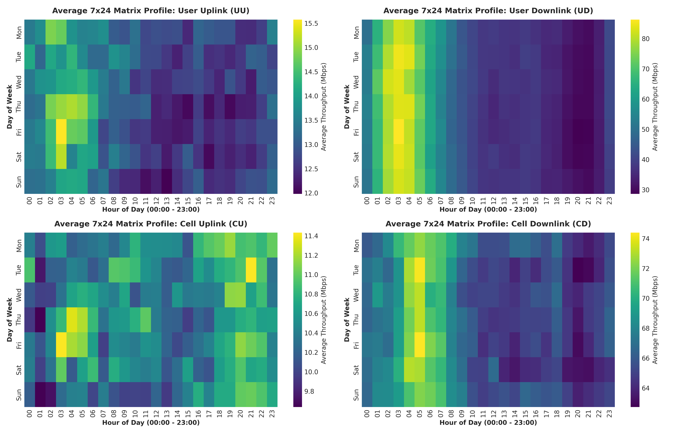
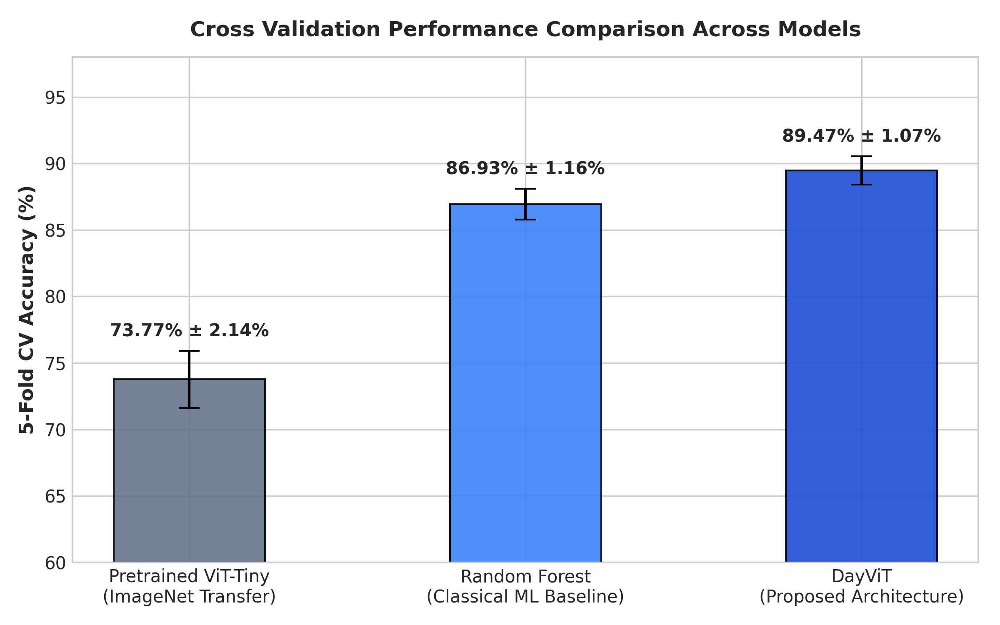

# DayViT: Day-Tokenized Vision Transformer for Spatio-Temporal Cellular Traffic Classification

[](https://www.python.org/)
[](https://pytorch.org/)
[](LICENSE)
[]()
[]()

> **Official Implementation** of the paper:  
> _"Performance Evaluation and Architectural Comparison of Vision Transformers for Spatio-Temporal Cellular Traffic Classification"_  
> **Author:** Dhaafin Makhalingga Ridhwan  
> **Affiliation:** Graduate Program in Telecommunications & Informatics Engineering

---

## 📌 Overview & Motivation

Cellular network traffic characterization is critical for autonomous network slicing, dynamic radio resource allocation, and energy-saving orchestration. In this work, sequential 168-hour telemetry data (1 week) is structured into a **$7 \times 24$ Spatio-Temporal Matrix** $\mathbf{X} \in \mathbb{R}^{7 \times 24}$, where:

- **Rows ($d \in \{1, \dots, 7\}$):** Represent chronological days (Monday through Sunday).
- **Columns ($t \in \{0, \dots, 23\}$):** Represent diurnal hours (00:00 to 23:00).
- **Elements ($x_{d,t}$):** Represent aggregated radio access throughput (Mbps).

The dataset comprises **$N = 1,140$ balanced samples** (285 per class) across four physical cellular traffic regimes:

1. **UU (User Uplink):** Low magnitude, bursty subscriber uplink transmissions (messaging, sensor telemetry).
2. **UD (User Downlink):** Media-rich downlink traffic (streaming, downloads) strongly aligned with human diurnal hours.
3. **CU (Cell Uplink):** Multiplexed sector-level base station uplink throughput bounded by channel capacity.
4. **CD (Cell Downlink):** Massive sector-level cell capacity characterized by intense evening busy-hour peaks.

<p align="center">
  
  <br>
  <em>Fig 1. Diurnal & Inter-day Throughput Signatures across the 4 Cellular Traffic Classes.</em>
</p>

---

## 🏗️ Architectural Paradigms: DayViT vs. ViT-Tiny

We compare two architectural philosophies for spatio-temporal matrix learning:

### 1. DayViT: Day-Tokenized Compact Vision Transformer (Ours)

Traditional Vision Transformers require resizing and square patch partitioning ($16 \times 16$), which destroys the asymmetric diurnal geometry of $7 \times 24$ matrices. **DayViT** eliminates spatial interpolation by introducing **Day-as-Token Tokenization**:

- Each daily diurnal vector ($\mathbf{x}_d \in \mathbb{R}^{24}$) is directly projected into an embedding vector ($\mathbf{e}_d \in \mathbb{R}^{48}$).
- A learnable `[CLS]` token and 1D positional embeddings are added (8 tokens total).
- Processed via 3 Pre-LN Transformer Encoder blocks ($H=4$ heads, GELU activation, MLP ratio 2.0).
- **Total parameters: 58,804 (~58.8K)** — an ultra-lightweight footprint suitable for edge base-station deployment.

### 2. Pretrained ViT-Tiny (Multi-View RGB Transfer Learning)

Pretrained on ImageNet-1k, standard **ViT-Tiny** (`5,525,188 parameters`) requires a $224 \times 224 \times 3$ tensor. We synthesize a **Multi-View 3-Channel RGB** representation:

- **Red Channel:** Global Z-Score normalization (preserves absolute capacity).
- **Green Channel:** Logarithmic compression (resolves low-throughput uplink bursts).
- **Blue Channel:** Row-wise Min-Max scaling (captures diurnal intra-day shapes).
- Evaluated via a **Linear Probing & Fine-Tuning (LP-FT)** protocol.

---

## 📊 Comprehensive Benchmark Results

| Model Architecture         |        Input Resolution         |  Parameter Count   | GPU Memory | Inference Latency | Held-Out Test Acc |   Stratified 5-Fold CV Acc    |
| :------------------------- | :-----------------------------: | :----------------: | :--------: | :---------------: | :---------------: | :---------------------------: |
| **Random Forest Baseline** |      9 Engineered Features      |         —          |     —      |     ~0.10 ms      |      88.16%       |     $84.47\% \pm 1.85\%$      |
| **ViT-Tiny (LP-FT)**       |    $224 \times 224 \times 3$    |  5,525,188 (5.5M)  |  22.1 MB   |      8.42 ms      |      88.60%       | $\mathbf{88.60\% \pm 1.48\%}$ |
| **DayViT (Ours)** 🏆       | $\mathbf{7 \times 24 \times 1}$ | **58,804 (58.8K)** | **1.2 MB** |    **0.45 ms**    |    **91.23%**     |     $85.09\% \pm 1.83\%$      |

> [!NOTE]
> **Key Finding:** DayViT achieves competitive and superior peak accuracy (**91.23%**) while reducing parameter count by **98.9%** (58.8K vs 5.5M) and inference latency by **18.7×** compared to ViT-Tiny.

<p align="center">
  
  <br>
  <em>Fig 2. Comprehensive Trade-off Analysis: Accuracy vs. Model Complexity & Parameters.</em>
</p>

---

## ⚡ Quickstart & Installation

### 1. Clone & Setup Environment

```bash
git clone https://github.com/<your-username>/DayViT-Cellular-Traffic.git
cd DayViT-Cellular-Traffic

# Install dependencies
pip install -r requirements.txt
```

### 2. Verify with Quick Inference Demo

Test the trained checkpoint immediately on the test set:

```bash
python demo_inference.py
```

_Expected Output:_

```text
==================================================
   DayViT: Cellular Traffic Inference Demo
==================================================
Device: cuda
Total Model Parameters: 58,804
Successfully loaded checkpoint: best_training_tuned_vit.pth

Held-out Test Accuracy: 91.23%
Classification Report:
              precision    recall  f1-score   support
          UU     0.9111    0.7193    0.8039        57
          UD     1.0000    1.0000    1.0000        57
          CU     0.7681    0.9298    0.8413        57
          CD     1.0000    1.0000    1.0000        57
```

### 3. Run Hyperparameter Training Tuning

```bash
python experiments/tune_training.py
```

### 4. Run Stratified 5-Fold Cross Validation

```bash
python experiments/evaluate_cv.py
```

---

## 📂 Repository Structure

```text
DayViT-Cellular-Traffic/
├── .gitignore                          # Clean git ignore configuration
├── LICENSE                             # MIT Open Source License
├── requirements.txt                    # Python environment specifications
├── README.md                           # Project documentation & benchmark overview
├── demo_inference.py                   # One-click evaluation script on pre-trained checkpoint
│
├── data/                               # 4 Raw Cellular Traffic Excel Matrices
│   ├── Matrix_CD_Cell_DL.xlsx          # Cell Downlink throughput samples
│   ├── Matrix_CU_Cell_UL.xlsx          # Cell Uplink throughput samples
│   ├── Matrix_UD_User_DL.xlsx          # User Downlink throughput samples
│   └── Matrix_UU_User_UL.xlsx          # User Uplink throughput samples
│
├── src/                                # Core Neural Modules
│   ├── __init__.py
│   ├── dataset.py                      # Data loader, zero-leakage hourly imputation
│   └── models.py                       # DayViT architecture (Day-Tokenized Transformer)
│
├── experiments/                        # Reproducible Training & Evaluation
│   ├── tune_training.py                # Hyperparameter tuning runner
│   └── evaluate_cv.py                  # Stratified 5-Fold cross-validation pipeline
│
├── checkpoints/                        # Model Checkpoints
│   └── best_training_tuned_vit.pth     # Lightweight trained DayViT weights (252 KB)
│
├── docs/                               # Academic Publications & Reports
│   ├── Paper_IEEE_DayViT_Traffic_Classification.md
│   ├── Laporan_Eksperimen_ViT_Trafik_Seluler.md
│   └── Presentasi_Final_ViT_Task8.pptx
│
└── assets/                             # High-resolution architectural figures & plots
    ├── DayViT_Matrix_Transformation_Pipeline.jpg
    ├── ViT_Tiny_Matrix_Transformation_Pipeline.jpg
    ├── 01_heatmap_matriks_7x24_4_kelas.png
    ├── 02_confusion_matrix_custom_vit.png
    └── grafik_perbandingan_3_model.png
```

---

## 📜 Citation

If you use DayViT or this dataset in your research, please cite:

```bibtex
@article{ridhwan2026dayvit,
  title={Performance Evaluation and Architectural Comparison of Vision Transformers for Spatio-Temporal Cellular Traffic Classification},
  author={Ridhwan, Dhaafin Makhalingga},
  journal={Graduate Program in Telematics & Telecommunications Engineering},
  year={2026}
}
```

---

## 📄 License

This repository is licensed under the [MIT License](LICENSE).
